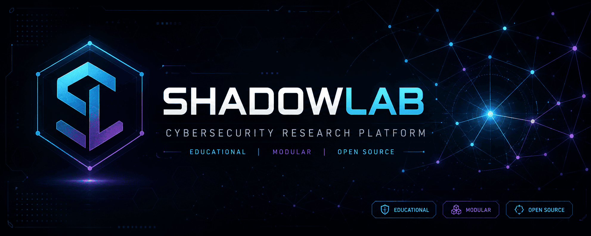

<div align="center">



# ShadowLab

### Educational Command & Control Framework

<br>

<p>

[Overview](#-overview) •
[Branch Status](#-branch-status) •
[Project Structure](#-project-structure) •
[Current Features](#-current-features) •
[Installation](#-installation) •
[Usage](#-usage) •
[Contributing](#-contributing) •
[Documentation](#-documentation)

</p>

<br>

[](https://python.org)
[]()
[](LICENSE)
[]()
[]()

<br><br>

**🔐 Encrypted Communications** •
**⚡ Async API / Async Server Refactor** •
**📦 Payload Builder** •
**🧩 Post-Exploitation Modules** •
**🎓 Cybersecurity Education**

</div>

---

> [!IMPORTANT]
>
> ShadowLab is an educational Command & Control (C2) framework designed for cybersecurity research, authorized lab testing, and controlled technical learning.
>
>
> **This project must never be used against systems without explicit authorization.**

# Overview

ShadowLab is a Python-based modular C2 framework for studying how modern remote management systems are structured, implemented, and operated in a controlled environment.

The project contains encrypted communications, payload generation, session management, asynchronous networking, and modular post-exploitation workflows in a single educational codebase. It is designed to help students, researchers, and developers understand the internal mechanics of a C2 system without turning the repository into a real-world offensive toolkit.


# Branch Status


```bash
git checkout refactor/async-api-architecture
```


# Project Structure

The codebase is split into functional areas for the C2 server, API layer, crypto logic, builder, session management, and post-exploitation modules.

```text
ShadowLab/
├── agent/
│   ├── builder/
│   │   ├── builder.py
│   │   └── pyi_progress.py
│   ├── post_exploit/
│   │   └── post_exploit_controller.py
│   └── templates/
│       ├── payload.py
│       └── payload_staged.py
├── api/
│   ├── __init__.py
│   ├── connection_protocol.py
│   ├── main.py
│   └── session_api.py
├── assets/
├── cli/
│   ├── options.py
│   ├── printer.py
│   ├── shell.py
│   └── system.py
├── confs/
│   ├── conf.json
│   ├── data.json
│   └── user_data.json
├── core/
│   ├── crypto/
│   │   └── encrypter.py
│   ├── enums/
│   │   ├── Modules.py
│   │   └── msg_types.py
│   ├── management/
│   │   ├── response_processor.py
│   │   ├── server_module_manager.py
│   │   ├── session_manager.py
│   │   └── session.py
│   ├── server/
│   │   ├── async_comm.py
│   │   ├── async_server.py
│   │   └── protocol.py
│   └── utils/paths.py
├── modules/
│   └── Keylogger/
│       ├── config.json
│       ├── controller.py
│       ├── keylogger.py
│       └── template.json
├── storage/
│   ├── binaries/
│   └── loot/
│       ├── logs/
│       ├── photos/
│       └── records/
├── Shadow.py
├── requirements.txt
├── README.md
├── CONTRIBUTING.md
├── FAQS.md
├── LICENSE
├── SECURITY.md
└── .gitignore
```

# Current Features

The checked-out development branch currently contains the following components:

## Core capabilities

- Encrypted communication flow between agent and server
- Session creation and tracking for connected clients
- Async TCP listener implementation
- FastAPI layer for listing sessions and queueing tasks
- CLI-driven configuration and startup workflow

## Payload and builder features

- Staged and unstaged Windows-oriented payload templates
- Builder options for Python source and Windows executable output
- Configuration values are read from local configuration files

## Session and management features

- Async TCP session creation and tracking
- Per-session command queues and session IDs
- Session cleanup when a client disconnects
- Task dispatch from the API to a connected session

## Post-exploitation module system

- Module discovery and template/controller integration are present
- The repository includes a Keylogger example module
- These components are in-progress functionality and should only be used in an isolated, authorized lab

## Current limitations

- The codebase is mid-refactor: newer async server/API components coexist with older synchronous CLI and module flows.
- The response endpoint is not complete: it reads from the session stream but does not return the response data; the TCP server also has its own reader for that stream.
- The API currently has no authentication and Uvicorn binds to `0.0.0.0:8080`. Do not expose it to untrusted networks; use only in an isolated lab.
- No automated test suite is currently included in the repository. Python compilation and project-module import checks pass in the current Python 3.13 environment.

The project is under active development and is not presented as a production-ready or hardened service.

# Installation

ShadowLab targets Python 3.13.x.

## 1. Clone the repository

```bash
git clone https://github.com/msalihberk/ShadowLab.git
cd ShadowLab
```

## 2. Check out the active development branch

```bash
git checkout refactor/async-api-architecture
```

## 3. Install dependencies

```bash
python -m venv .venv

# Windows
.\.venv\Scripts\Activate

pip install -r requirements.txt
```

## 4. Start the framework

```bash
python Shadow.py
```

# Usage

The project starts through a menu-driven CLI. Its current development flow supports selecting listener settings, starting the services, and viewing active sessions. Payload-building and module features are included as educational components; use them only in an isolated lab with explicit authorization.

## Typical lifecycle

```text
Start the CLI
    │
    ├── Select listener settings
    ├── Start the listener and API
    └── View connected sessions
```

## Main actions

- Start listener and API service
- View active sessions
- Configure IP address
- Configure port

## API usage

The current API routes are:

- `GET /api/v1/sessions` — list active sessions
- `POST /api/v1/agents/{session_id}/task` — queue a task for an active session

# Contributing

Contributions are welcome, especially for the active development branch.

## Recommended workflow

1. Fork the repository
2. Check out the development branch:

```bash
git checkout refactor/async-api-architecture
```

3. Create a feature branch:

```bash
git checkout -b feature/your-feature-name
```

4. Implement and test your changes
5. Open a pull request against the development branch

## Contribution areas

- async architecture cleanup
- session management improvements
- API stability and endpoint design
- module expansion and controller logic
- documentation and clarity improvements
- security-focused validation in isolated lab environments

Please read [CONTRIBUTING.md](CONTRIBUTING.md) before submitting changes.

# Documentation

| Document | Purpose |
| :--- | :--- |
| [README.md](README.md) | Project overview, current implementation status, and limitations |
| [CONTRIBUTING.md](CONTRIBUTING.md) | Contribution guidelines |
| [FAQS.md](FAQS.md) | Frequently asked questions |
| [SECURITY.md](SECURITY.md) | Responsible disclosure and vulnerability reporting |
| [LICENSE](LICENSE) | MIT license terms |

# Legal and Safety Notice

ShadowLab is intended exclusively for:

- cybersecurity education
- ethical research
- controlled lab work
- authorized security assessments

Unauthorized use against systems or networks without explicit permission is outside the intended purpose of this project.

---

<div align="center">

### Support the Project

If ShadowLab helps you learn, study, or build research tooling in a controlled environment, consider giving the project a GitHub star.

Made with ❤️ for the cybersecurity education community.

</div>
